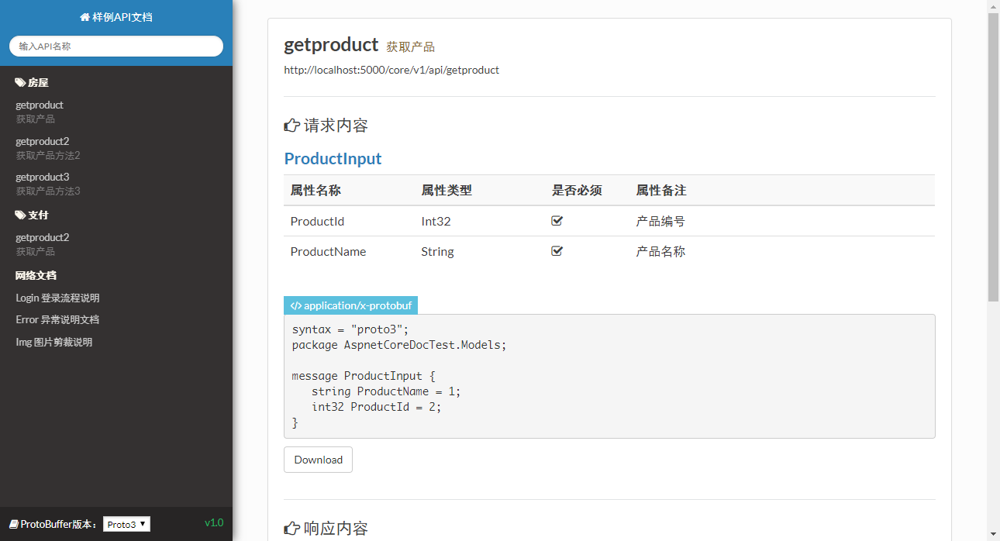
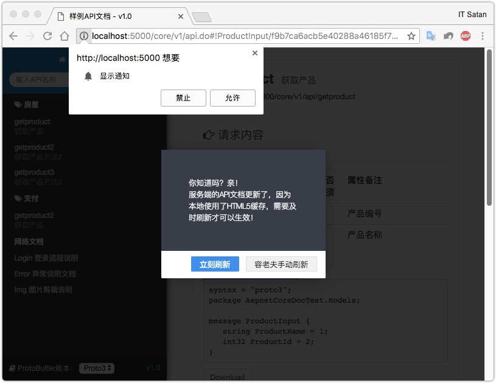
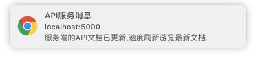

<div align="center">

# AspnetCoreApiDoc

### Auto-generated API docs for ASP.NET Core · Protobuf by default

[](https://travis-ci.com/li-keli/AspnetCoreApiDoc)
[](https://www.nuget.org/packages/AspnetCoreApiDoc)
[](https://github.com/li-keli/AspnetCoreApiDoc)
[](https://github.com/li-keli/AspnetCoreApiDoc)
[](LICENSE)
[](https://github.com/996icu/996.ICU)

**Function-oriented API documentation for App / internal clients**  
Build readable docs from interface definitions & XML comments, with built-in `application/x-protobuf` support

[中文](README.md) · [Quick start](#quick-start) · [Features](#features) · [Screenshots](#screenshots) · [NuGet](#install)

</div>

---

## About

**AspnetCoreApiDoc** is an ASP.NET Core library that **auto-generates API integration docs**, primarily for **mobile apps and internal backends**.

It is **not** a classic RESTful Swagger stack:

| Aspect | AspnetCoreApiDoc | Typical REST Swagger |
|--------|------------------|----------------------|
| API style | **Function-oriented** (by action / capability) | Resource-oriented REST |
| Default wire format | **Protocol Buffers** (`application/x-protobuf`) | Mostly JSON |
| Audience | App / internal developers | General HTTP API consumers |
| Live updates | WebSocket refresh hints on the doc page | Usually manual reload |
| Contract shape | **Proto2 / Proto3** snippets | OpenAPI / JSON Schema |

In short:

> Mark APIs with `[ApiDoc]`, keep XML comments, and get an internal integration handbook—with Protobuf as the first-class transport.

---

## Features

- **No hand-written HTML** — scan controllers & models + XML comments  
- **Protobuf first-class** — Input/Output formatters for `application/x-protobuf`  
- **Proto2 / Proto3** switch on the doc side  
- **Grouping & opt-out** — `[ApiDoc("Group")]` / `[ApiDoc(isCreateDoc: false)]`  
- **Live update toast** — WebSocket notifies open doc pages when the service changes  
- **CI badges** — optional Build / Coverage SVG on the doc page  
- **External links** — attach extra network docs (blog, wiki, etc.)  
- **Optional ES logging** — sample project includes Elasticsearch logger scaffolding  
- **Companion tool** — `tool/apiprotoasnic.go` batch-downloads `.proto` files  

---

## Screenshots

<p align="center">
  
  <br />
  <sub>Generated API document UI (endpoints · request/response · Proto)</sub>
</p>

| Live update hint | Toast bar |
|:----------------:|:---------:|
|  |  |

---

## Architecture

```text
Controllers / Actions / Models  --[ApiDoc]+XML-->  ApiGenerator (ApiExplorer)
                                                      |
                    +---------------------------------+--------------------------------+
                    v                                                                  v
            UI  GET {DocRouter}/api.do                                    JSON POST {DocRouter}/doc
                WS  {DocRouter}/ws                                        (Proto contract payload)

Business path:
  Client -- application/x-protobuf --> ProtobufInputFormatter --> Action
         <-- application/x-protobuf -- ProtobufOutputFormatter <--
```

| Endpoint (example `DocRouter = /core/v1`) | Purpose |
|-------------------------------------------|---------|
| `GET /core/v1/api.do` | Document HTML |
| `POST /core/v1/doc` | Document JSON data |
| `WS /core/v1/ws` | Live-update channel |

---

## Install

```powershell
Install-Package AspnetCoreApiDoc
```

```bash
dotnet add package AspnetCoreApiDoc
```

- NuGet: https://www.nuget.org/packages/AspnetCoreApiDoc  
- Published versions: `2.0.0` … `3.0.2` (badge: **v3.0.2**)

### Build from source

```bash
git clone https://github.com/li-keli/AspnetCoreApiDoc.git
cd AspnetCoreApiDoc
dotnet restore src/AspnetCoreDoc.sln
dotnet build src/AspnetCoreDoc.sln
dotnet run --project src/AspnetCoreDocTest
```

Open `http://localhost:5000/core/v1/api.do` (port depends on `launchSettings.json`).

---

## Quick start

### 1. Register (`ConfigureServices`)

```csharp
services.AddProtoMvc(op =>
{
    op.IsOpenDoc = true;
    op.ApiOptions = new ApiOptions
    {
        DocRouter = "/core/v1",
        ApiName = "Sample API Document",
        APiVersion = "v1.0",
        Copyright = "Copyright©2018-2011 api.com All Rights Reserved. ",
        ProtoBufVersion = ProtoBufEnum.Proto3,
        NetworkDocs = new List<NetworkDoc>
        {
            new NetworkDoc { Title = "Default Web Document", Url = "https://www.baidu.com/" },
            new NetworkDoc { Title = "My Blog", Url = "http://www.cnblogs.com/likeli/" },
        }
    };
});
```

`AddProtoMvc` registers MVC, Protobuf formatters, and doc generation.

### 2. Enable middleware (`Configure`)

```csharp
app.UseStatusCodePages()
   .UseApi();
```

### 3. Mark APIs

```csharp
[ApiDoc("Public APIs"), Route("core/v1/[controller]/[action]/")]
public class ApiController { /* ... */ }

/// <summary>Get product (POST)</summary>
[ApiDoc, HttpPost]
public ProductInput GetProduct2([FromBody] ProductInput input)
{
    return new ProductInput { ProductName = "All-in-one" };
}

// Exclude one action:
[HttpPost, ApiDoc(isCreateDoc: false)]
public ProductInput GetProductNoDoc([FromBody] ProductInput input) { /* ... */ }
```

### 4. Annotate models

```csharp
[ProtoContract]
public class ProductInput
{
    [ProtoMember(2)]
    public int ProductId { get; set; }

    [ProtoMember(1)]
    public string ProductName { get; set; }
}
```

### 5. Emit XML documentation

```xml
<PropertyGroup>
  <TargetFramework>netcoreapp2.0</TargetFramework>
  <DocumentationFile>bin\Debug\netcoreapp2.0\{project name}.xml</DocumentationFile>
  <DocumentationFile>bin\Release\netcoreapp2.0\{project name}.xml</DocumentationFile>
  <NoWarn>1701;1702;1705;1591</NoWarn>
</PropertyGroup>
```

Apply to the API project **and** projects that own shared models.

### 6. Open the doc

```text
http://localhost:5000/core/v1/api.do
```

See the full sample: [`src/AspnetCoreDocTest`](src/AspnetCoreDocTest).

---

## Repository layout

```text
AspnetCoreApiDoc/
├── img/                    # Screenshots
├── src/
│   ├── AspnetCoreApiDoc/   # Core library
│   ├── AspnetCoreDocTest/  # Runnable sample
│   └── AspnetCoreDocUnitTest/
├── tool/apiprotoasnic.go   # Batch download .proto
├── README.md               # Chinese
└── README-en.md            # This file
```

---

## Tool: batch download Proto

```bash
cd tool
go run apiprotoasnic.go -output output/ -platform dic
```

| Flag | Meaning |
|------|---------|
| `-output` | Output directory (default `output/`) |
| `-platform` | Group key, e.g. `api` / `dic` |

Adjust `targeUrl` inside the tool for your environment.

---

## Conventions

1. **Body-only inputs** — documented APIs should read parameters from the request body (`[FromBody]`), matching binary Protobuf payloads.  
2. **Accept filter** — when docs are enabled, non-document routes expect `Accept: application/x-protobuf` or may get 404.  
3. **Not classic REST** — organized by function/action, not strict resource REST.  
4. **Age of the codebase** — built around **.NET Core 2.x** (samples/CI: 2.0 / 2.2). Expect migration work for modern .NET; the design ideas still apply.

---

## Community

| Channel | Link |
|---------|------|
| Issues | https://github.com/li-keli/AspnetCoreApiDoc/issues |
| Gitter | https://gitter.im/AspnetCoreApiDoc/AspNetCoreApiDoc |
| NuGet | https://www.nuget.org/packages/AspnetCoreApiDoc |

---

## License

- [MIT License](LICENSE)  
- 996ICU [License](https://github.com/996icu/996.ICU/blob/master/LICENSE)

---

<div align="center">

**Define the API and comments once — ship docs and Protobuf contracts together.**

[中文 README](README.md)

</div>
