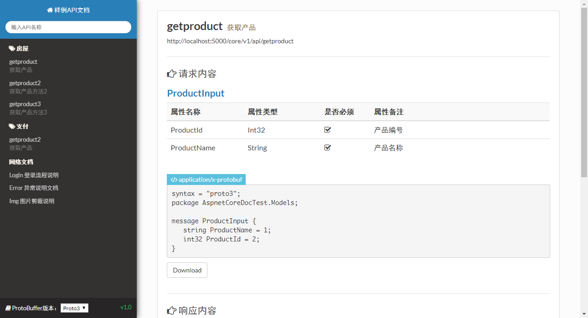
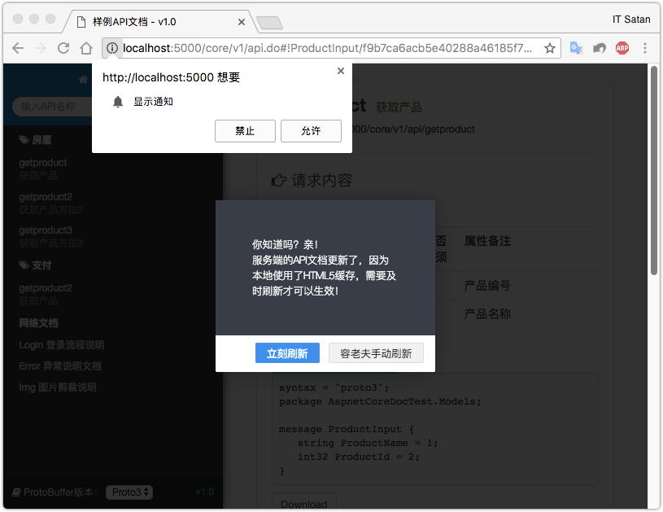
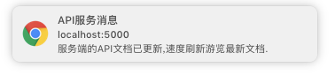

<div align="center">

# AspnetCoreApiDoc

### ASP.NET Core 自动生成 API 对接文档 · 默认 Protobuf 传输

[](https://travis-ci.com/li-keli/AspnetCoreApiDoc)
[](https://www.nuget.org/packages/AspnetCoreApiDoc)
[](https://github.com/li-keli/AspnetCoreApiDoc)
[](https://github.com/li-keli/AspnetCoreApiDoc)
[](LICENSE)
[](https://github.com/996icu/996.ICU)

**面向 App / 内部客户端的功能型 API 文档框架**  
从接口定义与 XML 注释自动生成可读文档，并内置 `application/x-protobuf` 序列化支持

[English](README-en.md) · [快速开始](#快速开始) · [功能特性](#功能特性) · [文档示例](#文档效果) · [NuGet](#安装)

</div>

---

## 简介

**AspnetCoreApiDoc** 是一套运行在 **ASP.NET Core** 上的 API 文档自动生成组件，主要为 **移动端 / 内部系统对接** 场景设计。

它与常见 Swagger / OpenAPI 工具的定位不同：

| 对比维度 | AspnetCoreApiDoc | 典型 RESTful Swagger |
|----------|------------------|----------------------|
| API 风格 | **面向功能**（按 Action / 业务能力组织） | 面向资源的 REST |
| 默认序列化 | **Protocol Buffers**（`application/x-protobuf`） | 多为 JSON |
| 文档用途 | 给 App / 内部开发者的对接手册 | 通用 HTTP API 契约 |
| 实时协作 | WebSocket 推送文档更新提示 | 通常需手动刷新 |
| 契约形态 | 可导出 **Proto2 / Proto3** 描述 | OpenAPI / JSON Schema |

一句话概括：

> 根据带 `[ApiDoc]` 标记的接口与 XML 注释，自动生成给内部开发者使用的 API 对接文档；传输层默认走 Protobuf，而不是传统 REST + JSON。

适合：为 App 提供后端服务、内网 RPC 风格 HTTP API、需要统一 Protobuf 契约与在线文档的团队。

---

## 功能特性

- **零手写 HTML**：扫描控制器与模型，结合 XML 注释生成文档页  
- **Protobuf 一等公民**：内置 Input / Output Formatter，媒体类型 `application/x-protobuf`  
- **Proto2 / Proto3**：文档侧可切换 Protobuf 版本  
- **分组与裁剪**：`[ApiDoc("分组名")]` 分组；`[ApiDoc(isCreateDoc: false)]` 排除单个 Action  
- **实时更新提示**：文档页通过 WebSocket 感知服务端变更并即时提示  
- **CI 徽章嵌入**：支持配置 Build / Coverage 的 SVG 地址展示在文档页  
- **扩展网络文档**：可挂载外部说明链接（博客、规范、Wiki 等）  
- **可选 ES 日志**：示例工程含 Elasticsearch 日志接入骨架  
- **配套工具**：`tool/apiprotoasnic.go` 可批量下载接口对应的 `.proto` 文件  

---

## 文档效果

<p align="center">
  
  <br />
  <sub>自动生成的 API 文档界面（接口列表 · 请求/响应模型 · Proto 描述）</sub>
</p>

| 文档更新实时提示 | 更新提示条 |
|:----------------:|:----------:|
|  |  |

部署新版本后，已打开文档页的同事无需手动刷新即可收到更新提示。

---

## 架构一览

```text
┌──────────────────┐     [ApiDoc] + XML 注释      ┌─────────────────────┐
│  Controller /    │ ──────────────────────────▶  │  ApiGenerator        │
│  Action / Model  │                              │  (扫描 ApiExplorer) │
└──────────────────┘                              └──────────┬──────────┘
                                                             │
         ┌───────────────────────────────────────────────────┤
         │                                                   │
         ▼                                                   ▼
┌─────────────────────┐                          ┌───────────────────────┐
│ 文档 UI              │  GET  {DocRouter}/api.do │  文档 JSON 数据         │
│ 内嵌 api.html        │  POST {DocRouter}/doc    │  含 Proto 契约片段      │
│ WebSocket 热更新提示  │  WS   {DocRouter}/ws     │                       │
└─────────────────────┘                          └───────────────────────┘

业务请求路径：
  Client ── application/x-protobuf ──▶ ProtobufInputFormatter
                                      ──▶ Action
                                      ──▶ ProtobufOutputFormatter ──▶ Client
```

| 端点（示例 `DocRouter = /core/v1`） | 作用 |
|------------------------------------|------|
| `GET /core/v1/api.do` | 文档 HTML 页面 |
| `POST /core/v1/doc` | 文档结构化数据（JSON，可带 Proto 版本） |
| `WS /core/v1/ws` | 文档热更新提示通道 |

---

## 安装

### NuGet

```powershell
Install-Package AspnetCoreApiDoc
```

或：

```bash
dotnet add package AspnetCoreApiDoc
```

- 包地址：https://www.nuget.org/packages/AspnetCoreApiDoc  
- 已发布版本：`2.0.0` ~ `3.0.2`（README 徽章以 **v3.0.2** 为准）

### 从源码构建

```bash
git clone https://github.com/li-keli/AspnetCoreApiDoc.git
cd AspnetCoreApiDoc
dotnet restore src/AspnetCoreDoc.sln
dotnet build src/AspnetCoreDoc.sln
# 运行示例
dotnet run --project src/AspnetCoreDocTest
```

浏览器打开：`http://localhost:5000/core/v1/api.do`（端口以 `launchSettings.json` 为准）。

---

## 快速开始

### ① 注册服务（`ConfigureServices`）

```csharp
services.AddProtoMvc(op =>
{
    op.IsOpenDoc = true; // 开放文档访问
    op.ApiOptions = new ApiOptions
    {
        // 文档路由前缀；推荐与业务 API 前缀一致
        DocRouter = "/core/v1",
        ApiName = "样例API文档",
        APiVersion = "v1.0",
        Copyright = "Copyright©2018-2011 api.com All Rights Reserved. ",
        ProtoBufVersion = ProtoBufEnum.Proto3,
        // BuildSvg / CoverageSvg 可填 CI 徽章地址
        NetworkDocs = new List<NetworkDoc>
        {
            new NetworkDoc { Title = "默认网络文档一", Url = "https://www.baidu.com/" },
            new NetworkDoc { Title = "我的博客", Url = "http://www.cnblogs.com/likeli/" },
        }
    };
    // 可选：ES 日志
    // op.ESOptions = new ESOptions { Uri = "http://192.168.0.1:9200", DefaultIndex = "test-log" };
});
```

`AddProtoMvc` 会同时：

1. 注册 MVC  
2. 挂载 Protobuf Input / Output Formatter  
3. 启用文档生成（`AddApi`）

### ② 启用中间件（`Configure`）

```csharp
app.UseStatusCodePages()
   .UseApi(); // 启用 API 文档（内部 UseMvc + WebSockets + ApiMiddleware）
```

### ③ 标记需要出文档的接口

**控制器级（推荐：整组接口统一分组）：**

```csharp
[ApiDoc("公共API文档"), Route("core/v1/[controller]/[action]/")]
public class ApiController
{
    // ...
}
```

**方法级：**

```csharp
/// <summary>
/// 获取产品方法2
/// </summary>
/// <param name="input">输入参数</param>
/// <returns>输出参数</returns>
[ApiDoc, HttpPost]
public ProductInput GetProduct2([FromBody] ProductInput input)
{
    return new ProductInput { ProductName = "一体机" };
}
```

**排除某个 Action：**

```csharp
[HttpPost]
[ApiDoc(isCreateDoc: false)]
public ProductInput GetProductNoDoc([FromBody] ProductInput input) { /* ... */ }
```

### ④ 模型标注 Proto 契约

```csharp
[ProtoContract]
public class ProductInput
{
    /// <summary>产品编号</summary>
    [ProtoMember(2)]
    public int ProductId { get; set; }

    /// <summary>产品名称</summary>
    [ProtoMember(1)]
    public string ProductName { get; set; }
}
```

### ⑤ 生成 XML 文档注释

在 API 项目及**被引用模型所在项目**的 `.csproj` 中启用 XML 文档输出，以便注释进入文档页：

```xml
<PropertyGroup>
  <TargetFramework>netcoreapp2.0</TargetFramework>
  <DocumentationFile>bin\Debug\netcoreapp2.0\{项目名}.xml</DocumentationFile>
  <DocumentationFile>bin\Release\netcoreapp2.0\{项目名}.xml</DocumentationFile>
  <NoWarn>1701;1702;1705;1591</NoWarn>
</PropertyGroup>
```

> 提示：旧版双重 `DocumentationFile` 写法以仓库示例为准；较新 SDK 可改用 `<GenerateDocumentationFile>true</GenerateDocumentationFile>`，并自行确认 XML 路径是否被组件加载。

### ⑥ 访问文档

```text
http://localhost:5000/core/v1/api.do
```

---

## 完整 Startup 示例

```csharp
public class Startup
{
    public Startup(IConfiguration configuration)
    {
        Configuration = configuration;
    }

    public IConfiguration Configuration { get; }

    public void ConfigureServices(IServiceCollection services)
    {
        services.AddSingleton<IHttpContextAccessor, HttpContextAccessor>();
        // services.AddSingleton<ESClientProvider>(); // 可选 ES

        services.AddProtoMvc(op =>
        {
            op.IsOpenDoc = true;
            op.ApiOptions = new ApiOptions
            {
                DocRouter = "/core/v1",
                ApiName = "样例API文档",
                APiVersion = "v1.0",
                Copyright = "Copyright©2018-2011 api.com All Rights Reserved. ",
                ProtoBufVersion = ProtoBufEnum.Proto3,
                NetworkDocs = new List<NetworkDoc>
                {
                    new NetworkDoc { Title = "默认网络文档一", Url = "https://www.baidu.com/" },
                    new NetworkDoc { Title = "我的博客", Url = "http://www.cnblogs.com/likeli/" },
                }
            };
        });
    }

    public void Configure(IApplicationBuilder app, IHostingEnvironment env, ILoggerFactory loggerFactory)
    {
        app.UseStatusCodePages()
           .UseApi();
    }
}
```

更完整可运行工程见：[`src/AspnetCoreDocTest`](src/AspnetCoreDocTest)。

---

## 仓库结构

```text
AspnetCoreApiDoc/
├── img/                              # README / 文档截图
│   ├── Sample-img.png                # 文档主界面
│   ├── 2018-04-11_11.06.png          # 热更新提示
│   └── 2018-04-11_11.07.png
├── src/
│   ├── AspnetCoreDoc.sln
│   ├── AspnetCoreApiDoc/             # 核心库（可打包 NuGet）
│   │   ├── Constant/                 # ApiDocSetting、ESOptions 等
│   │   ├── Extensions/               # 扩展方法、序列化辅助
│   │   ├── Filter/                   # XML 注释 Schema 过滤
│   │   └── Proto/
│   │       ├── ProtobufInputFormatter.cs
│   │       ├── ProtobufOutputFormatter.cs
│   │       ├── ProtobufOperation.cs  # AddProtoMvc
│   │       └── Doc/                  # 文档生成、中间件、内嵌 HTML
│   ├── AspnetCoreDocTest/            # 可运行示例（Controller / 模型 / ES 骨架）
│   └── AspnetCoreDocUnitTest/        # 单元测试
├── tool/
│   └── apiprotoasnic.go              # 批量下载 .proto 的 Go 小工具
├── README.md
├── README-en.md
└── LICENSE
```

---

## 配套工具：批量下载 Proto

[`tool/apiprotoasnic.go`](tool/apiprotoasnic.go) 用于根据文档接口批量拉取并保存 `.proto` 文件（支持 Proto3），便于客户端代码生成流水线使用。

```bash
cd tool
go run apiprotoasnic.go -output output/ -platform dic
```

| 参数 | 说明 |
|------|------|
| `-output` | 下载目录，默认 `output/` |
| `-platform` | 目标平台分组，如 `api` / `dic` 等 |

源码较短：请求文档 JSON → 解析分组 → 写出 Request / Response 对应的 proto 文本。使用前请按实际环境修改工具内的 `targeUrl`。

---

## 约定与注意

1. **请求体约定**：所有纳入文档的 API，入参应从 **Body** 读取（`[FromBody]`），与 Protobuf 二进制体传输一致。  
2. **Accept 过滤**：开启文档后，业务请求侧中间件会对非 `application/x-protobuf` 的 Accept 返回 404（文档路由除外）——客户端需正确设置媒体类型。  
3. **非 REST 风格**：按功能 / Action 组织接口，而不是严格的资源型 REST。  
4. **时效说明**：主体面向 **.NET Core 2.x** 时代（示例与 CI 使用 2.0 / 2.2）；在 .NET 6/8 上直接引用需自行评估 API 兼容与迁移成本。思路（属性标记 + XML 注释 + Protobuf 契约 + 内嵌文档页）仍可复用。

---

## 技术栈

| 组件 | 用途 |
|------|------|
| ASP.NET Core MVC | 宿主与 ApiExplorer |
| protobuf-net | .NET 侧 Protobuf 序列化 |
| 内嵌 `api.html` | 文档前端 UI |
| WebSocket | 文档热更新提示 |
| Newtonsoft.Json | 文档元数据 JSON |
| Travis CI | 历史 CI（`master` / `vue-ui`） |
| Go（tool） | 批量导出 proto |

---

## 交流与反馈

| 渠道 | 链接 |
|------|------|
| Issues | https://github.com/li-keli/AspnetCoreApiDoc/issues |
| Gitter | https://gitter.im/AspnetCoreApiDoc/AspNetCoreApiDoc |
| NuGet | https://www.nuget.org/packages/AspnetCoreApiDoc |

欢迎 Star、提 Issue 或 PR。

---

## License

- [MIT License](LICENSE)  
- 996ICU [License](https://github.com/996icu/996.ICU/blob/master/LICENSE)

---

<div align="center">

**写好接口与注释，文档与 Protobuf 契约一并交付。**

[English README](README-en.md)

</div>
